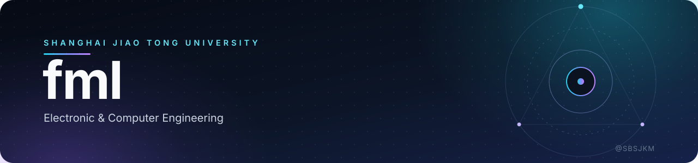

<!--
  ✏️ 这是你的 GitHub 主页 README（仓库名必须与你用户名相同）。
  横幅在 assets/banner.svg，发布步骤、学生认证见 SETUP.md。
-->

  

  
  

## 👋 你好，我是 fml

本科在读，方向是**具身智能**。我喜欢把「机器人怎么学会干活」拆成一个个具体的小问题：
**数据从哪来、仿真像不像真、人怎么插手最省力、推理延迟怎么藏起来。**

- 🎓 **上海交通大学（SJTU）** · 电子与计算机工程（ECE）
- 🔬 研究兴趣：机器人操作的**数据效率** —— 人类干预数据、人机共享控制、仿真到真机的迁移
- 🧪 手头在做：VLA 模型微调基准（`π0.5` / `GR00T N1.7`）+ Isaac Lab 场景与数据生成
- 🦿 也折腾过：四足机器人稀疏地形运动、视觉语言导航（VLN）
- 📮 邮箱：sbsjkm13@sjtu.edu.cn

## 🧰 技术栈

  
  
  
  
  
  
  
  
  
  

## 📌 精选项目

### [hil-vla-shared-control](https://github.com/SBSJKM/hil-vla-shared-control)

面向 VLA 微调的**人类干预数据 + 共享控制 + 实时动作块衔接（RTC）**基准。

- 复现 5 种策略更新范式，窄槽装配成功率 **31% → 100%**
- 主从接管无跳变：关节速度跳变 **13.5 → 1.16 rad/s**
- 240 ms 跨机延迟下 RTC 平滑衔接，块边界冲击 **↓ 92.8%**

`Python` · `PyTorch` · `Isaac Lab` · `LeRobot`

 

  <picture>
    <source media="(prefers-color-scheme: dark)" srcset="https://raw.githubusercontent.com/SBSJKM/SBSJKM/output/github-contribution-grid-snake-dark.svg" />
    <source media="(prefers-color-scheme: light)" srcset="https://raw.githubusercontent.com/SBSJKM/SBSJKM/output/github-contribution-grid-snake.svg" />
    
  </picture>

## 🤝 交流

对**机器人操作数据**、**VLA 微调**、**人机共享控制**感兴趣，或者想一起复现某篇工作？欢迎开 Issue 或直接邮件我。

  
    
  「把复杂留给系统，把简单留给用户。」

